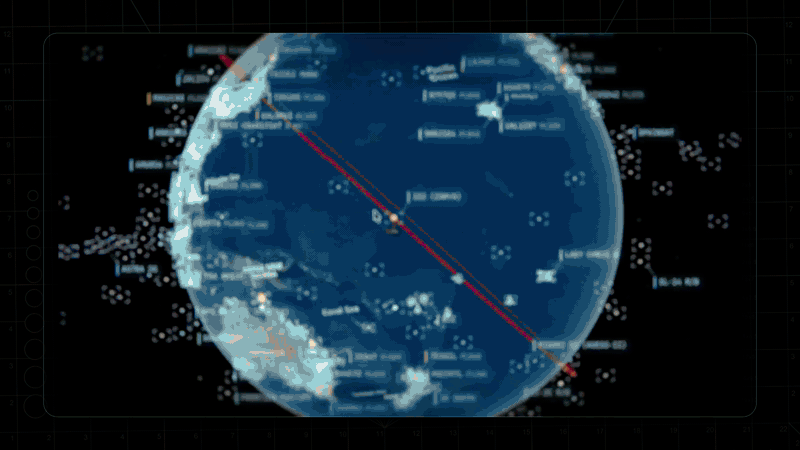

<div align="center">

# 🌐 Panorama

**A spy-satellite cockpit in your browser, built entirely from public data.**

Photorealistic 3D globe · live aircraft, ships and satellites · earthquakes, weather and public cameras · hands-free voice control



</div>

---

Panorama puts flight transponders, ship beacons, orbital elements, seismographs and public cameras on one explorable globe. Zoom from the whole planet down to a single aircraft, vessel or street corner, lock the camera onto a target, and talk to the map instead of clicking through it.

It is vanilla JavaScript on **CesiumJS** and **Vite**, with **Google Photorealistic 3D Tiles** for the terrain and the **OpenAI Realtime API** for voice. Nothing is framework-heavy, and every layer is its own module.

> **Credit.** Panorama is built on [God's Eye View](https://github.com/bilawalsidhu/gods-eye-view) by [Bilawal Sidhu](https://github.com/bilawalsidhu) and [Sameh Khamis](https://github.com/samehkhamis) (MIT). The original license and third-party notices are kept in [LICENSE](LICENSE) and [THIRD_PARTY_NOTICES.md](THIRD_PARTY_NOTICES.md).

## Features

| | |
|---|---|
| 🛩️ **Cockpit view** | Ride inside a tracked flight with the camera holding terrain under you |
| 🎯 **Click to track** | Lock on to any aircraft, ship or satellite, with a fading trail and full metadata |
| 🎙️ **Voice control** | Fly the camera, filter layers and annotate the world by speaking |
| 🎨 **Sensor looks** | CRT, night vision, FLIR thermal, noir and snow shaders over the real globe |
| 🛰️ **Satellite passes** | SGP4 orbits, plus "when does it next rise over me" |
| 🌦️ **Weather** | GFS and ECMWF wind, radar, satellite clouds, lightning and cyclone tracks (no key) |
| 📷 **Street level & CCTV** | Mapillary, KartaView, Panoramax and public camera feeds |
| 🎥 **Scene director** | Record cinematic camera tours and share them as files |
| 🔗 **Share links** | Camera, layers and a tracked target serialize into a URL |

Most layers work without an API key. Optional keys (Google Maps, OpenAI, OpenSky, AISStream, TomTom and others) are added inside the app under **POWER UP → Provider Settings** and are brokered through a server-side proxy.

## Quick start

Requires **Node.js 24.14+** (or 26.x).

```bash
git clone https://github.com/ker0s3ner/Panorama.git
cd Panorama
npm ci
npm run doctor   # checks your Node version and setup
npm run dev
```

Open <http://localhost:4173> and pick **Live Contacts**, **Space Missions**, **Environmental** or **Explore Manually**.

**Docker:**

```bash
docker compose up
```

Other scripts: `npm run build`, `npm test`, `npm run format:check`.

## How it works

- **Smooth motion from choppy data.** Live feeds update every 15-30 s, so the globe renders one interval behind real time and interpolates, with dead reckoning in the gaps.
- **True headings.** Aircraft and ship icons point along their real-world course at every camera angle.
- **Grounded entities.** Heights are aligned to Google 3D tiles so aircraft park on aprons instead of floating.
- **Server-side secrets.** Private keys never reach the browser. The proxy has SSRF protection, response caps and sanitized errors.

```
src/
├── main.js        bootstrap, 3D tiles, layer registration
├── ui.js          panels, HUD, control facade
├── layers/        weather, wind, cyclones, transit, ALPR, ...
├── data/          one module per data layer, plus bundled datasets
├── voice/         realtime voice session and tools
├── scenes/        cinematic scene director
└── ...
server/            hardened key-brokering proxy
docs/              architecture, design system, data-pack and director docs
```

Start with [docs/CURRENT-STATE.md](docs/CURRENT-STATE.md) for the runtime reference.

## Data and responsible use

Panorama models events, assets and infrastructure: aircraft, vessels, satellites, fires, cameras, cities. It is not built for tracking individuals.

Data can be delayed, modeled, incomplete or wrong. **Do not use it for navigation, emergency response or any safety-critical purpose.** Each data source has its own terms; see [DATA_SOURCES.md](DATA_SOURCES.md). Security model: [SECURITY.md](SECURITY.md).

## Contributing

See [CONTRIBUTING.md](CONTRIBUTING.md) and [TESTING.md](TESTING.md).

## License

[MIT](LICENSE) © Bilawal Sidhu, with Panorama changes by Benas Petronis. Bundled datasets and media carry their own terms; see [docs/media/README.md](docs/media/README.md).
